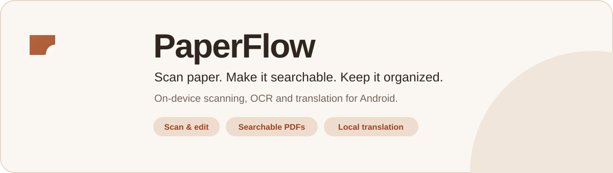
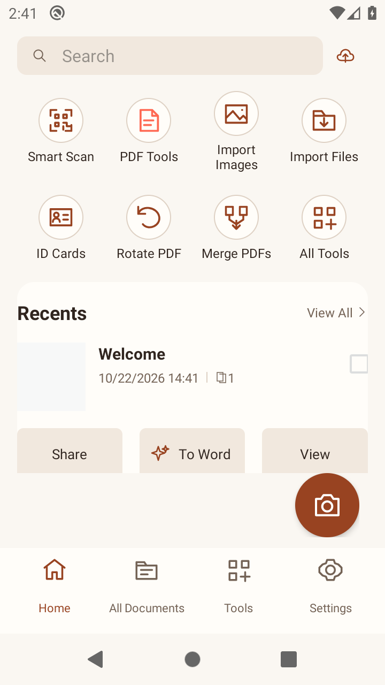
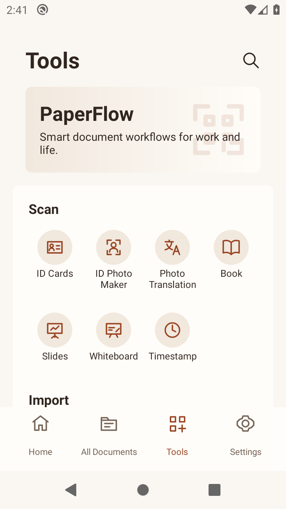
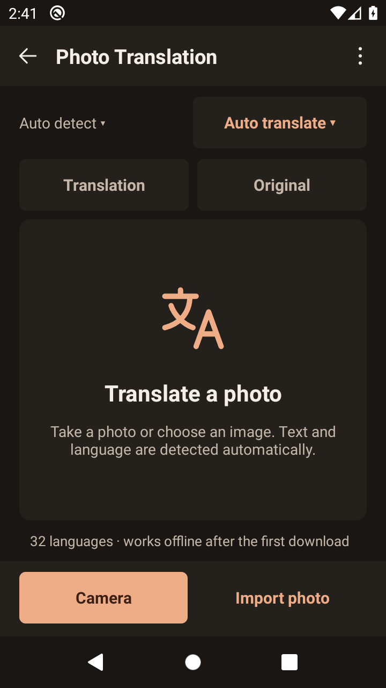
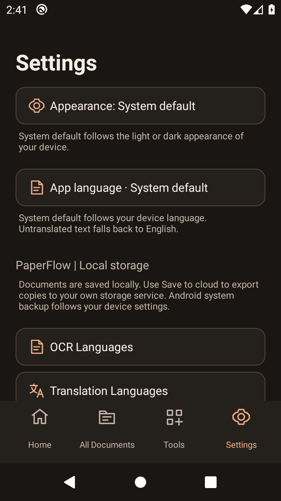
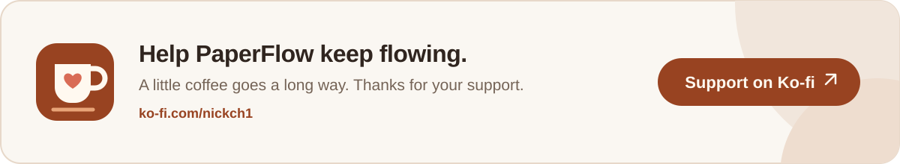

  

  
  
  

# PaperFlow

**An open-source Android app for scanning, editing and organizing documents.**

Scan paper, create searchable PDFs and translate photos on your device

[Download](https://github.com/NickCh11/PaperFlow/releases/latest) | [Features](#features) | [Screenshots](#screenshots)

## Screenshots

<table>
  <tr>
    <td align="center"> <b>Home · Light</b></td>
    <td align="center"> <b>Document tools · Light</b></td>
  </tr>
  <tr>
    <td align="center"> <b>Translation · Dark</b></td>
    <td align="center"> <b>Settings · Dark</b></td>
  </tr>
</table>

## Features

### 📷 Scan and import

| Tool | Description |
|---|---|
| **Smart Scan** | Scan pages with live boundaries and automatic perspective correction. |
| **Batch Scan** | Capture several pages in one document. |
| **Book** | Scan book spreads and crop each page separately. |
| **ID Cards** | Scan both sides of an ID card. |
| **Slides** | Capture presentation slides. |
| **Whiteboard** | Scan whiteboards into readable documents. |
| **Timestamp** | Add a timestamp to your scans. |
| **Import Images / Import Files** | Open existing photos, PDFs and supported Office files. |
| **Default / PaperScan Pro** | Keep the original appearance or enhance your scans. |

### 🔎 OCR and translation

| Tool | Description |
|---|---|
| **OCR PDF** | Make selected PDF pages searchable and their text copyable. |
| **Batch OCR** | Recognize text in multiple documents at once. |
| **Translation** | Translate scans and images offline, with all pages exported as PDF or images. |

### 📄 PDF tools

| Tool | Description |
|---|---|
| **PDF reader** | Read, search and copy text from PDFs. |
| **PDF Edit** | Add highlights, drawings, shapes and comments. |
| **Replace text** | Correct text in a scanned region. |
| **Redact** | Remove selected content from an exported PDF copy. |
| **Rotate PDF** | Rotate individual pages with a live preview. |
| **Merge Files** | Combine multiple PDFs. |
| **Extract PDF Pages** | Save selected pages as a new PDF. |
| **Reorder Pages** | Change the order of document pages. |
| **Sign** | Add signatures, stamps and dates. |
| **Add Watermark** | Place your own text watermark on pages. |
| **Erase Marks** | Remove small marks with a brush and pinch zoom. |
| **Compress** | Reduce PDF image size where possible. |
| **Lock / Remove PDF password** | Add or remove a PDF password with authorized access. |
| **Page setup and numbering** | Adjust page size, orientation and numbering. |
| **Print** | Print selected pages through Android. |

### 🔄 Convert and create

| Tool | Description |
|---|---|
| **To Word** | Export documents as DOCX files. |
| **To Excel** | Export recognized tables as XLSX files. |
| **To PowerPoint** | Turn document pages into PPTX presentations. |
| **Office to PDF** | Convert DOCX, XLSX and PPTX files to PDF. |
| **PDF to Images** | Export selected pages as JPEG or PNG images. |
| **PDF to Long Image** | Combine pages into one long image. |
| **Collage** | Arrange photos and PDF pages in a layout. |
| **ID Photo Maker** | Create ID photos with custom framing and backgrounds. |
| **Scan Code** | Read QR codes and barcodes. |

### Word export modes

- **Editable text (recommended):** copies existing PDF text, using offline OCR for scanned pages. Produces simple text you can edit; original layout, tables and fonts are not preserved.
- **Copy existing PDF text:** copies only text already in the PDF. A photo or scan without a text layer cannot be recognized in this mode. This includes Greek text; it does not translate into Greek.
- **Read text from scans (offline OCR):** recognizes every page using enabled OCR languages, even if the PDF already contains text. Produces simple editable text.
- **Text boxes over page background:** places individual editable text boxes at approximate page positions over an image background. This is not a normal flowing Word document; fonts and graphics around scanned text may change. Scans need enabled OCR languages.
- **Pages as pictures:** inserts each page as an image. Its text cannot be edited in Word and OCR is not run.

### 📂 Organize and personalize

- **Library:** organize documents with folders, favorites, tags, search and Trash.
- **Folder protection:** restrict access with a PIN or biometrics.
- **Export:** save to your device, share or manually save through providers such as Google Drive and OneDrive.
- **Appearance:** choose light, dark or system default.
- **App language:** follow the device language or choose an available translation; English is currently bundled.

## Models and processing engines

| Feature | Models / data | Runtime and integration |
|---|---|---|
| Offline translation | [Firefox Translations models](https://github.com/mozilla/firefox-translations-models), from Mozilla; current project: [mozilla/translations](https://github.com/mozilla/translations) | [slimt](https://github.com/jerinphilip/slimt), using the [DavidVentura fork](https://github.com/DavidVentura/slimt) through `slimt-sys` and `translator-rs`. |
| Offline OCR | [PaddleOCR](https://github.com/PaddlePaddle/PaddleOCR) detection and recognition models | [MNN](https://github.com/alibaba/MNN), through the offline-translator runtime. The same OCR engine serves scans, searchable PDFs and Word conversion. |
| Automatic language detection | [CLD2](https://github.com/CLD2Owners/cld2) language data | CLD2 in `translator-rs`. |
| Translation document alignment | [DocAligner lcnet050](https://github.com/DocsaidLab/DocAligner) | MNN in the translation runtime. |
| Scan page detection / PaperScan Pro | [FairScan segmentation model v1.2.0](https://github.com/pynicolas/fairscan-segmentation-model) | LiteRT for segmentation; [FairScan](https://github.com/pynicolas/FairScan) image processing and OpenCV for enhancement. |
| Curved book page correction | [UVDoc](https://github.com/tanguymagne/UVDoc), converted to ONNX | ONNX Runtime Android and OpenCV. |
| ID photo background | MediaPipe Selfie Segmenter float16 v1 | LiteRT. |

The Android language integration is adapted from [offline-translator](https://github.com/DavidVentura/offline-translator) and pins [translator-rs](https://github.com/DavidVentura/translator-rs/tree/a1e232488007cfe28b9198da1a3351cf32078ef9). Its lockfile resolves `slimt-sys` at `1cef6a655b713aef25695eba8451d10ac1c4f21a`, whose slimt source is pinned at `2beb403abfff5b2f4c165a6d51362c973d037e97`. These are specific source revisions; this does not imply a security certification of the fork.

Language packs come from the offline-translator v6 catalog and its model host, `offline-translator.davidv.dev`. Packs share common files and enable OCR automatically after a successful download when OCR resources are available. See [model distribution](docs/MODEL_DISTRIBUTION.md) for download checks and limitations, and [third-party notices](THIRD_PARTY_NOTICES.md) for licenses, bundled model hashes and attribution. PaperFlow uses PDFBox-Android for PDF operations. Dictionary and TTS engines from the broader offline-translator ecosystem are not PaperFlow features.

## Contributing

See the [build instructions](docs/BUILD.md), [contribution guide](CONTRIBUTING.md), [translation guide](docs/TRANSLATING.md) and [GitHub Actions checks](docs/CI.md).

## Privacy

Core processing, including OCR and translation, runs locally. Language pack downloads and update checks need internet access; document images and text are not uploaded for processing.
Folder protection controls app access and is not an encrypted vault.

## License

**GPL-3.0-or-later** — see [LICENSE](LICENSE) and [third-party notices](THIRD_PARTY_NOTICES.md).

  

